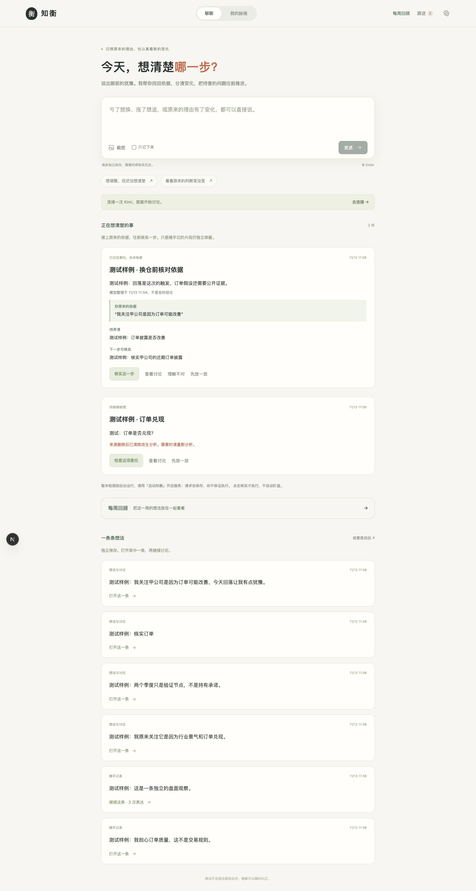
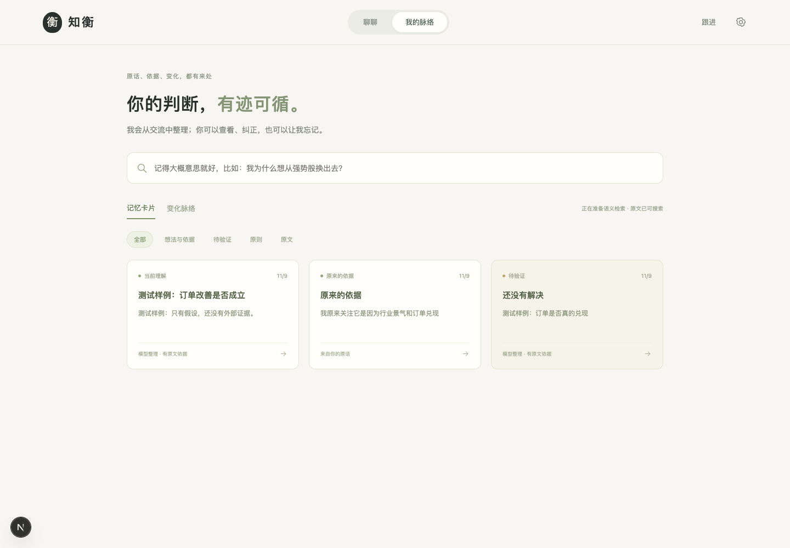
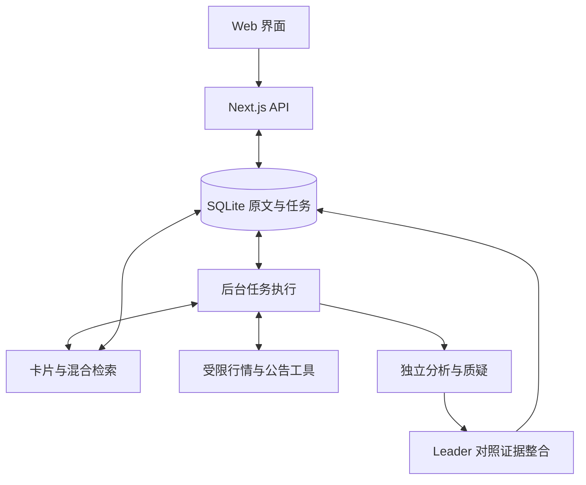

# 知衡 · 投资 Personal Agent

服务于一个人的投资决策过程：找回原来的依据，核实眼前的变化，帮助用户辨别是否正在改变评价标准。允许有依据地调整，避免把坚持原计划或临时改变自动视为正确。

这是一个公开源码、在本机运行的个人验证项目，使用 AI 编程工具辅助实现与测试。目前没有公众在线服务、商业用户或收益验证。文字、多 Agent 审议、历史接续、纠正、手动跟进与截图理解已有真实 Kimi 调用验证；检索与模型判断仍需持续评估。

**当前里程碑：v0.3.0 · 每周思绪回顾（个人验证预览版）。** 在可纠正的混合检索记忆之上，加入可选的每周自动回顾：真实后台调度、有原文依据、可纠正并保留版本。

快速了解项目：[产品与工程案例](docs/PROJECT_CASE_STUDY.md) · [版本记录](CHANGELOG.md) · [验证方法](TESTING.md) · [GitHub Releases](https://github.com/zzx-abc/zhiheng-personal-agent/releases)

## 为什么做这个产品

投资者可能记得近期涨跌，却忘记最初为什么关注、后来什么证据改变了判断。知衡围绕这个连续过程设计：随口表达 → 找回相关原文 → 必要时查证 → 对照原依据与新选择 → 保存可纠正的理解。首次使用可以直接得到帮助，不要求先填写交易体系。

项目主要验证三件事：个人理解能否有据可查，纠正能否在下一次交流中生效，以及委托是否有真实执行状态。不将收益率或买卖点预测作为验收指标。

## 界面预览

以下为隔离测试环境截图，记忆内容均明确标记为测试样例，不包含个人投资记录或密钥。





## 技术结构

| 层次 | 实现 |
| --- | --- |
| Web 界面与接口 | Next.js 16、React 19、TypeScript、自定义 CSS |
| 模型运行 | DeepSeek Harness SDK/runtime，调用 Kimi API |
| 持久数据 | SQLite：原文、记忆、观点版本、任务、报告与证据 |
| 混合检索 | FTS5/BM25 + 本地 multilingual-e5-small 向量 + RRF 融合 |
| 后台执行 | Node.js worker，数据库队列与任务状态校验 |
| 验证 | Node Test Runner、Playwright、Zod 输入输出校验 |



Harness 负责模型运行，业务程序负责工具、任务和持久记忆。多个审议角色目前使用同一模型，不能把角色数量当作独立证据数量。复杂判断走独立审议，简单回顾与纠正不强制生成三份报告。

## 打开与开始使用

双击 `启动知衡.command`。等待构建后，打开 http://127.0.0.1:3210 。终端保持运行；关闭终端或电脑休眠后不能持续执行。已保存的 API 配置和原文不会因为重新构建而丢失。

需要 Node.js 24.9+。在克隆后的项目目录执行：

```bash
npm ci
npm ci --prefix runtime/dsh --ignore-scripts
npm run memory:setup
npm run build
npm start
```

日常只需要一个输入框：

- 发一句问题、一整段投资论证，或上传/粘贴截图。默认由 Agent 理解任务，不必选择模型工作流。
- 简单问题直接回答。复杂投资判断自动独立检查支持依据和反例，再由 Leader 整合。
- 持续关注的问题会从交流中自然形成；下次从首页“接着上次”进入。新问题不会强行混入旧议题。
- 输入框中的“只记下来”仅保存原文，不调用模型。语音可使用系统键盘听写；暂不上传录音。
- 点击“理解不对？”，或直接说“那只是我的担心，不是交易规则”。原文保留，旧理解会撤回。
- 说“这个问题后面帮我继续跟进”，保存的是一个**手动委托**。在右上角“跟进”点击“立即检查”才执行。
- 没查到相关材料，或材料不足以回答问题，会显示“还缺关键证据”；不把检索成功当作事实已证实。

用户无需预先填写投资体系、持仓、情绪标签，也无需管理多个 Agent。

## 决策体验：前台简单，后台保留完整依据

前端已整体重写：主导航是“聊聊”和“我的脉络”。首页是直接输入与独立片段列表；每条保留自己的原话、回答与追问，打开一条才接续对应讨论；“我的脉络”提供记忆卡片、原文检索和变化时间线。跟进和连接设置是辅助入口。两条开场提示可编辑，不自动发送。卡片从交流自然形成，不要求用户填写后台字段。

针对“当天亏损、热点上涨、想调整”的情境，分析和质疑分别检查原有依据与新选择，不把行业基本面自动等同中线，也不把想换仓当实际成交。复杂比较仍然独立审议；简单回顾和纠正不重复生成三份报告。

每个关注的工作状态可带一份 `decision_frame`：原来的依据、本人明确的观察周期、考虑中的调整、触发情况。四项均允许未知，保存的内容必须逐字引用用户原文且来源存在，和原状态一起版本化、纠正、删除。它不代表用户认可的交易原则，不把模糊表达升级为规则。老数据不需要迁移；原文不会被覆盖。

产品不会自动读取券商持仓或屏幕。用户没有表达的想法、没有确认的交易都不能假定发生。首版评估的是减少重复解释、识别评价标准变化、纠正生效，而非提高收益。

## 本次改进：持续推进一个问题

除了聊天和记忆，每个关注现在有独立持久保存的工作状态：

- 正在验证的假设、当前判断、关键前提、支持与反向材料。
- 哪些新证据会改变判断、哪些问题尚未解决、下一步为什么值得做。
- 每次有实质更新保存一个版本，保留来源、更新时间和变化。日常无需确认表单。
- 状态是模型对问题的整理，明确区别于你认可的交易原则。可直接纠正；纠正后停用旧状态，原文删除会清理全部派生版本。
- 下次进入同一关注，直接继续对话；从“我的脉络”检查判断、来源和历史变化，从“跟进”查看委托。后续模型也读取当前状态和关联原文。

查证现在是有停止条件的小闭环：规划一个查询 → 执行 → 判断材料是否解决问题 → 必要时调整一次查询 → 独立审议 → 更新工作状态。最多两次搜索、六份材料。来源不足时保存具体卡点和继续需要的材料，不把查证完成当作研究目标完成。

建议与委托仍然分开：模型提出下一步不会自动执行；明确要求现在查、点击“查证这一步”或执行已保存的委托，才会调用外部工具。任务由本机worker执行，页面关闭不影响已启动任务；本机服务和电脑需保持运行。行情与公告仍无自动监测或推送；每周思绪回顾有独立的可选定时入口。

分析和质疑保持独立。Leader可以否决查证环节的“已解决”判断，并将执行结果降为证据不足；不会因为多个角色同意就把用户假设升级为事实。

## 独立片段与按需关联

新输入默认独立保存，不按同一公司、相同标题或最近关注事项自动合并。前端用原文片段及真实追问关系展示对话，后台另存 `record_context` 的父片段与根片段；现有旧记录保持原文与时间，不猜测它们原本是否属于同一段交流。手动跟进仍可针对明确关注事项执行。

模型先看当前输入及明确回复链，判断是否需要历史。普通记录、盘面概览、材料足以回答的问题不调用全库检索；当调整判断、新信息核对等任务需要个人背景时主动提出检索词和理由，不要求用户说“上次”或挑选卡片；明确回顾与纠正也能触发。程序执行混合检索后再回答，留下 `memory_requested` / `memory_retrieved` 记录。命中内容只是参考，不会改写片段的归属，也不代表旧观点仍然有效。新问题即使写在旧讨论里，也可由模型识别并拆为独立片段；这一语义判断仍可能出错，需要实际使用持续验收。

全库索引可以持续建立，但检索不在每次回答中默认执行。当前回复链可直接用于澄清，只有需要时才取回其他片段。长期关注工作状态只在明确接续相应问题时使用，不把旧持仓当成盘面概览的默认对象。原文卡片在默认记忆列表中可见，时间线是查看连续问题的视图，不是所有记录的强制归宿。

隔离测试覆盖独立输入、追问、换话题拆分、按需回顾、同名关注不合并、删除父片段后的原文保留。`node --import tsx scripts/live-fragments.ts --live` 是显式付费的真实模型验收，使用本机已配置连接和标注的虚构记录；结果留在被忽略的 `data/`，开发用量回计本机总额，不重置或提高预算。

### 标签、关联与反馈闭环

- 自动标注对象、主题、任务性质与明确提及的周期，每个标签有原文片段和生成来源。普通交流复用任务理解调用提取标签；“只记下来”和旧记录先用本地词规则提供有限标签，不新增付费调用。标签只是检索线索，提及公司不等于持有，提及短线不等于长期风格。
- 混合检索保留全文与本地向量，增加标签候选通道（RRF 权重 0.6）；标签越常见，候选通道内权重越低。同一来源去重，最多返回六张候选卡片。调整任务可主动寻找原始依据和验证条件，无需用户引导历史检索。
- 利用已有的检索后理解调用验证关系，逐字核对当前引用与历史引用。`0.40 × 任务相关 + 0.20 × 对象匹配 + 0.25 × 问题匹配 + 0.15 × 有效性` 达到 0.75 且通过来源、时间和对象约束才进入最终回答，最多三条。分数是启发式，不是校准概率；同股和共同标签本身不能证明同一件事。
- 只有完成的回答才持久保存关联提议。用户可查看原因与原文，选择“关联准确”“不是这件事”，补充说明或撤销反馈。明确的自然语言关联纠正也能写入真实反馈。点击卡片、沉默、模型重复结论不会被当作认可。
- 否认后，同一回复链默认排除对应历史来源，相关旧回答和工作状态标为过时；用户明确要求回看或重新比较时仍可找回原文，旧关系不自动恢复。相同明确对象、标准任务标签和周期的新片段仅降低优先级（0.45）并附带纠正说明，不将一次否认泛化成永久规则；确认的关联仅获得有限排序增益（1.15），不凭空增加候选。
- 标签可以改名或移除，旧标签留有纠正记录，索引和重复模型提取不会恢复同一个已撤回标签。原文不变。关系及反馈随来源删除级联清理，导出包含标签、关联和反馈历史。用户仍需自行处理旧备份。

这一版积累的是可追溯的关系与反馈，不训练模型参数，也不保证每次语义判断正确。`node --import tsx scripts/live-memory-learning.ts --live` 用标注的虚构记录进行真实付费验收，结果只写被忽略的 `data/`，费用回计开发用量；不用于 CI。

### 每周思绪回顾

首页“每周回顾”提供“现在回顾最近 7 天”和一个自动开关。默认关闭；开启后每周一 09:00（Asia/Shanghai）整理上一完整自然周，首次开启安排下一次未来时点。输出为关注点、判断变化和记录尚未回答的问题，每项可展开逐字原文引用。回顾单独保存，不合并原始片段、不自动创建原则或改写卡片。

- 调度由现有 Node worker 执行，`weekly_schedule` 保存下次到期时间与最近检查时间。页面关闭不影响执行；电脑和本机服务必须保持运行。长时间离线后只补最近一期，不累计生成多份旧周报。
- 自动时段唯一约束与事务防止重复排队。同一期失败、缺 Key、超预算或后台中断后等待手动重试，不无限重复计费。关闭自动开关取消未完成的自动回顾；手动回顾独立处理。
- 本期按时间筛选最多30条文字原文；超过时在整个区间均匀选取，明示覆盖条数。每条最多400字符；使用本期对象/主题标签触发既有混合检索，最多补3条更早原文（每条600字符），只是候选背景，不因同股建立关系。回顾纠正纳入上下文，总数据上限24,000字符，超限明确失败。
- 一次模型整理调用，使用现有真实模型连接与预算；Harness 格式修复最多额外一次。不调用多个审议角色、不查询新行情，不重新解析截图。空周跳过，不调用模型。覆盖范围、截取情况和未解析图片数量随结果保存。
- 每条归纳必须包含本期来源，引用需匹配实际传入的逐字片段；判断变化至少有两条不同原文。结构与引用验证不能保证语义归纳正确。没有足够依据的栏目可以留空。
- “纠正这份回顾”保存专属于本期的原话说明并停用旧回顾；重新生成沿用原时间范围和纠正，保存新版本。反馈不变成全局交易规则。删除来源清除引用它的派生回顾；执行期间的纠正或删除阻止旧结果写回。
- 可以删除回顾而保留投资原文。已删除的自动时段保留最小时间标记，避免调度再次生成。导出格式 v5 包含调度、回顾版本、来源关系和纠正；历史备份需另行清理。

这是一份基于记录的阶段整理，不是完整成交复盘；少量相似表达不能证明稳定行为模式。真实 Kimi 虚构场景已验证首份生成与纠正后再生成，整体质量仍需个人长期验收。执行 `node --import tsx scripts/live-weekly-review.ts --live` 会计费，结果仅保存到被忽略的 `data/`，开发费用回计现有预算。

## 历史检索与上下文预算

已经实现 SQLite FTS5/BM25 全文检索 + 本地 multilingual-e5-small 语义向量 + RRF 排名融合，加入来源标签候选通道，按独立来源去重并结合明确反馈调整排序，最多选择六张候选卡片，再验证其中哪些原文可用于回答。中文使用分词和双字片段。384维向量存入本地SQLite，个人规模直接计算余弦相似度，不另建向量数据库。模型来源：[官方模型卡](https://huggingface.co/Xenova/multilingual-e5-small)。

首次运行 `npm run memory:setup` 从官方站点下载公开权重，需要能访问 Hugging Face。之后索引与检索只用本地 CPU，不发送给远程 embedding 服务，不需要新增 Key。若需已有代理，可为下载命令配置 `HTTPS_PROXY` 和 `NODE_USE_ENV_PROXY=1`，不写死代理地址。语义模型不可用时明确降级为全文检索。测试实际加载模型并检索改写表达，没有使用假向量。

卡片保存类型、来源ID、所属事项、状态与版本。已有模型工作状态和记忆归纳形成依据、判断、待验证问题、原则等卡片；未经过模型整理的历史标记为原文。后台增量补齐向量，内容变化使索引失效，不为每句话额外增加一次归纳调用。变化脉络目前是时间线，尚不是自动知识图谱或可编辑思维树。

回答上下文保留当前输入；只在确实接续对应问题时携带当前工作状态，对历史、记忆、证据、旧模型判断分别分配字符预算，并设置序列化数据上下文24,000字符的硬上限。字符预算不是精确Token数；系统提示和审议报告另有开销。必要核心内容本身超限时明确提示，不悄悄截断用户当前问题。

历史长文只选取原文片段，尽量围绕当前决策引用或纠正的原话截取，标记片段位置和截取事实。数据库原文不变，用户仍可查看全文。纠正、认可原则优先于旧模型结论；只有明确提及历史图片时才重传最多两张历史图片，当前上传图片正常处理。截取不能保证语义召回完整，这是后续混合检索需要验证的地方。

纠正会保留新原话，停用相关旧判断与原记忆；撤回内容退出有效全文和向量检索。原则候选需要认可。删除原文清理派生卡片和向量，正在生成的过期结果不能写回。历史版本可以查看，但不作为当前理解检索。RAG改善相关背景召回，不保证检索与理解始终正确，仍需长期评估。

## 月度预算与上下文是两件事

“剩余预算不足以预留此次分析”来自本机月度累计预算，不是模型上下文窗口。设置分别显示模型报告用量、未知用量预估、执行中预留，以及已包含在总量中的开发验证消耗。默认本机上限为100万Token，可在设置中调整；修改上限不会重置已有用量。这个上限不等于供应商人民币余额，不会自动充值。

旧版本为输出预留16,000，而实际参数上限为8,192。一次性迁移只校正这部分预留，未知用量继续计入，并留下审计事件。新请求先预留，再按供应商报告结算；确定未发请求的失败释放预留，计费不明则保守计入。独立审议临近预算上限时等待其他调用结算，避免并发预留互相挤占。应用估算不能替代供应商账单。

任务识别只读精简个人背景；Leader读取本次原始证据与两份审议的标注节选，不重复接收整份历史。完整审议仍可查看。若两份审议已完成、仅最后整合被预算拦截，重试可接续原步骤；个人背景发生修改或委托暂停后不复用旧审议。月度预留仍是估算，不能保证所有模型请求都能在剩余额度内启动。

## 模型与运行方式

Key 在右上角齿轮“连接与设置”填写。密钥只发给本机后端；不要贴进聊天。保存配置不是连接验证，可点“测试连接”。Kimi 开放平台 Key 与聊天会员不同。

默认执行层为 DeepSeek Harness SDK/runtime **0.2.2-rc.1**，独立安装在 `runtime/dsh`。三个角色由本应用编排，使用独立上下文；分析和质疑并行，Leader 按证据整合，不按多数票决定。它们使用同一模型，不是三个独立信息源。

- 模型可见工具清单为空；deny-all 限制工具执行。保留必要的 native executor，并在启动时验证空批次可执行。
- 查证、调度、记忆与数据库写入由应用程序负责，模型没有终端或任意文件操作权限。
- 三个角色的报告、事件、来源和用量都会保存。可以查看原文，不用相信一份无法追溯的总结。
- 工具由应用层规划器选择并校验执行，目前可选择公告搜索或腾讯行情。Harness原生终端/文件等工具仍关闭；这不限制应用提供的行情工具。单纯问价只生成一份回答，投资走势比较仍独立审议。
- `kimi-k3` 系列明确使用 `reasoning_effort: low`；输出额度按角色分配：规划2048、独立审议3072、普通回答与最终整合最多6144 Token。保留推理与独立审议。
- 每次模型请求最多150秒；整体任务最多330秒。失败可手动重试，没有无限重试或静默切换模型。
- 回复仅有格式问题时，先清理完整JSON外的代码围栏；仍不合法则通过同一模型和运行层进行至多一次格式修复，记录额外用量。修复仍需通过结构与来源校验，不补造事实，不重跑工具。
- 设置中的“直接 Kimi API”用于排查兼容性，不会自动启用。

首次连接问题已修复：原配置误禁用了 Harness 必需的执行器。错误提示现在区分执行器、身份验证、限速和输出截断，并隐藏密钥。

## 信息查证的范围

已接入腾讯网页行情工具：沪深A股、上证指数、沪深300、科创50、深证成指和创业板指。模型判断回答需要价量数据时，可选择工具取数，不必先让用户找截图。旧状态曾建议提供行情截图时，页面也提供“先用行情工具查”入口。

- 报价通过 `https://qt.gtimg.cn/q=...`，GB18030解码；日K通过 `https://web.ifzq.gtimg.cn/appstock/app/fqkline/get`。本机实测无需额外API Key；只向腾讯发送证券代码，不发送个人对话、持仓或Kimi密钥。
- 每次最多三个证券（含至多一个比较基准），一次批量报价及每证券一次日K；报价缓存30秒，日K缓存5分钟。十秒请求超时、不跟随重定向、不自动重试，没有后台轮询。
- 保存供应商行情时间、原抓取时间、接口地址及解码后的原始响应。抓取时间不能当作行情时间；返回旧交易日时明确标注，不推断交易日历或停牌状态。
- 个股使用实际返回的前复权日K，指数使用不复权日K。程序计算5/20/60个收盘间隔的涨跌，并按共同日期计算相对基准的百分点差。保守排除抓取日K线，避免盘中未完成成交量污染比较；这可能在收盘后也少用当日数据。
- 成交量保留供应商原始单位，不跨证券相加；只计算同一证券最近5个完整日相对此前5日的量比。没有将成交量转换成资金净流入。当前不提供分时、全市场成交额占比、行业指数目录或订单数据。
- 原始返回保存在来源中，可点击核对并随数据导出。给模型的上下文只传规范化结果和程序计算，避免每轮重复传完整原始报文。有限个股样本不能代替行业指数。

这是腾讯网页使用的接口，未找到正式开放API文档、稳定性或再分发授权承诺；本机验证按尽力可用处理，失败或格式变更明确留下缺口。正式经营时再确认数据使用条件。已核对的第一方入口为[腾讯行情页面](https://gu.qq.com/sz002371)及其加载的腾讯行情脚本。

使用 Kimi 官方 `search_pro` 与 `fetch` 接口。最多两次自适应查询、六份材料，限定巨潮资讯及沪深北交易所来源。新公告使用近30天窗口；季度经营指标可用近90天披露作为背景，实际范围写入执行记录。搜索返回日期不当作发布日期；来源路径过旧则排除，路径日期和原文发布日期也分开标注。行业问题只选有限公开披露样本，不代表全行业。

记录材料日期、读取时间、URL，以及正文/片段/摘要的区别。来源存在并不证明模型解读正确；用户原文只能证明用户这样表达过，不能证明资金流向等市场事实。

暂不提供：有实时性保证的交易所行情、分时资金监测、自动下单、后台自动盯盘、微信聊天读取、券商成交同步。接口缺数据时可以分析逻辑与检验条件，不能虚构“今天”的资金行为。

## 数据与安全

- SQLite WAL 保存原文、观点、关注、工作状态版本、委托和执行结果；截图单独存储。
- Key 位于 `data/credentials.json`（0600权限）或 `.env.local`，不进入前端、导出、备份或 Git。
- 普通明确目标/偏好可在逐字原文验证后保留；原则和模型推断需要用户认可。频繁行为不会自动变成交易纪律。
- 纠正可撤回旧理解；已失效报告不会用于后续判断。执行期间的纠正或删除会阻止旧结果写回。
- 删除原始来源会保守清理相关记忆和派生报告。历史备份不会自动擦除，需要另行清理。
- 当前仅绑定 `127.0.0.1`，限制跨站请求。手机布局已测试，但**尚未开放手机局域网访问**；下一步需认证与 HTTPS。
- 电脑关闭或休眠时没有全天执行保证。恢复后中断任务会标记失败，避免偷偷重试计费。

## 备份与恢复

先停止 Web/worker，再运行：

```bash
npm run backup
```

生成 `backups/<时间>/agent.sqlite`、附件和说明，不包含 Key。恢复时也先停止服务，恢复数据库与附件后移除旧的 `agent.sqlite-wal`、`agent.sqlite-shm`，再启动。不要覆盖运行中的数据库。

本机备份不能防磁盘损坏。正式持续使用前，应增加外置盘或加密异地备份。

## 验证

```bash
npm run typecheck
npm test
npm run harness:check
npm run test:ui
npm run build
```

真实场景验证需要明确调用，会使用已保存的 Key 并计入预算：

```bash
node --import tsx scripts/live-decision.ts --live
node scripts/live-image-check.mjs --live
```

决策验证使用明确标注的匿名测试情境，在隔离数据库中检查独立审议、来源、纠正与历史接续。图片验证使用标注为测试样例的图像。测试输入不进入正式个人历史；真实调用会计入当前预算，报告只保存在被 Git 忽略的 `data/` 下。

Token 预算包含失败时未报告用量的保守预留；搜索另计。费用以 Kimi 实际账单为准。完整验收说明见 `TESTING.md`。

## 仓库维护

仓库保存源码、测试与运行说明。个人原文、API配置、数据库、备份、下载模型、截图和本地实验记录均不提交；GitHub代码副本不代替个人数据备份。

每次围绕一个明确改动提交，运行对应测试，通过后推送。较大改动使用分支与PR；不强制推送、不自动合并第三方PR。两个package-lock.json分别固定应用和Harness依赖，使用npm ci安装。

用户可感知的迭代同时更新版本记录与相关验证说明；重要里程碑同步包版本并建立 GitHub Release。展示材料明确区分已实现、已验证与计划，不用测试用例数量代替效果指标，不上传私人验证报告。

GitHub Actions仅运行无Key的程序测试、类型检查和构建；不配置真实模型密钥，不运行付费验收。首次语义模型测试会下载公开权重。浏览器测试在本机运行，截图留在忽略目录。
